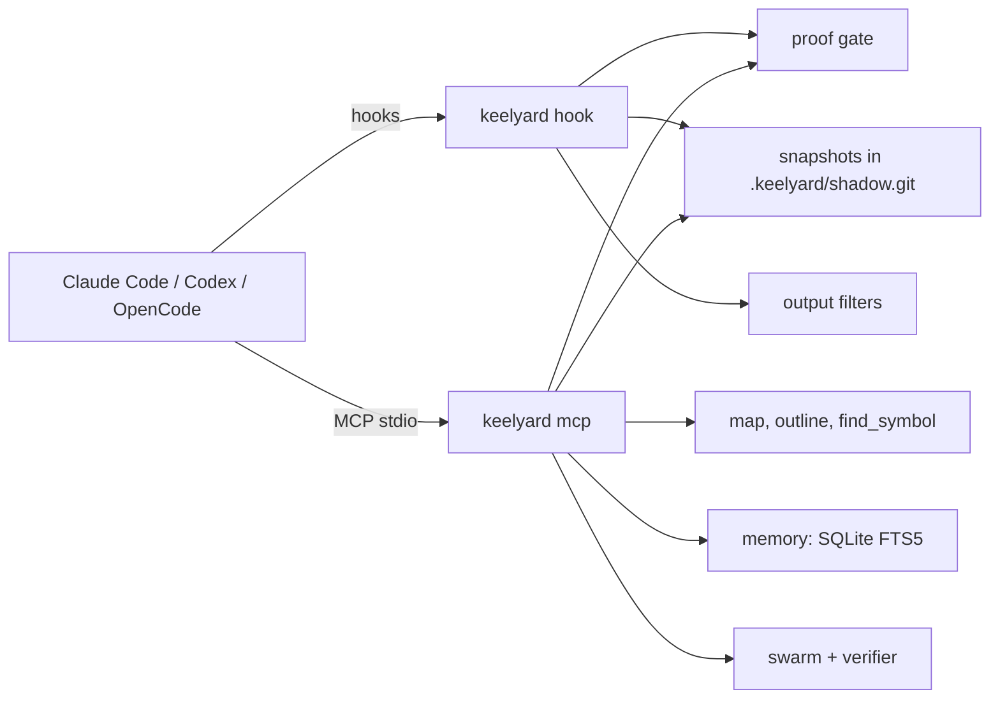

<div align="center">

# keelyard

**Your coding agent has to show its work before it can say "done".**<br>
Every edit is snapshotted, so any step can be undone. Logs are trimmed before they eat the context window.

[](https://github.com/akobirjontulqinovfuture/keelyard/actions/workflows/ci.yml)
[](LICENSE)


</div>

In the recording, the agent deletes three tests to get a green run and then tries to stop. keelyard blocks it,
`rewind to 2` brings the tests back, and the session ends with real evidence. Every line of output is real.
The agent's own edits are replayed from [`docs/demo/hero.sh`](docs/demo/hero.sh).

## Quickstart

```bash
pipx install git+https://github.com/akobirjontulqinovfuture/keelyard   # or: pip install ...
cd your-project
keelyard init            # finds Claude Code, Codex and OpenCode and wires each one
```

Then use your agent as usual. `keelyard status` shows where things stand, and `keelyard doctor` checks
the setup. `keelyard selftest` runs a scripted agent through the whole flow in a temporary folder.

## What it does

**Proof gate.** When an agent changed files, its Stop hook will not let it finish until three things are true:
there is a checklist of what you asked for, every item has evidence, and the tests passed after the last edit.
Each run produces a one-file HTML report you can attach to a PR. [Example](docs/img/proof-report.png).

**Rewind.** Each edit and shell command is snapshotted into a separate git repository under `.keelyard/`.
Your own `.git` is never touched. `keelyard rewind list`, `show`, `to` and `fork` work by step number, and
`keelyard rewind list -i` opens a browser for the timeline. A rewind snapshots the current state first,
so you can undo it.

**Smaller context.** Command-aware filters for git, pytest, cargo, go, jest, grep, find, ruff, eslint and mypy
keep every failure and `file:line` and drop the rest. In Claude Code the filtered output replaces the original,
and `keelyard recall <id>` gets the full text back. Reading an unchanged file a second time returns a one-line
notice instead of the whole file. `project_map`, `outline` and `find_symbol` let the agent find code
without reading it end to end.

**Memory and usage.** One full-text index covers your past Claude Code, Codex and OpenCode sessions
(`memory_search`). There is also a token and cost table built from local logs (`keelyard usage`).

**Swarm and arena.** `swarm` hands bulk reading or drafting to a cheap model and checks every `path:line` it
cites. `arena` runs one task across several agents and models and reports pass rate, time and tokens.

## For agents

`keelyard init` writes everything an agent needs to find its way:

- an MCP server with 20 tools. Each tool has a typed schema, an example in every parameter and JSON output.
- a short section in `CLAUDE.md` or `AGENTS.md` that describes the workflow
- for Claude Code, a skill (`.claude/skills/keelyard`) and the slash commands `/keelyard:status`,
  `/keelyard:prove` and `/keelyard:undo`

Every CLI command also accepts `--json` and uses stable exit codes: `0` ok, `1` error, `2` usage error,
`3` a check did not pass.

## Measured

All numbers come from this repository's scripts, run on an 8-vCPU Linux machine on 2026-10-12. Details and
caveats are in [docs/BENCHMARKS.md](docs/BENCHMARKS.md).

| | |
|---|---|
| Output filters vs raw, 8 real commands | 56,522 → 5,901 tokens; 100% of extracted facts kept |
| Same 8 commands through rtk 0.51 | 5,747 tokens; 24% of ruff and 71% of pytest facts kept |
| Snapshot after an edit, Django (7,083 files) | 88 ms median, 2.3 s for the first snapshot |
| Feature matrix: CLI, hooks, MCP tools, agent self-test | 110 / 110 cases pass ([table](docs/feature-matrix.md)) |
| Swarm with a 1.5B local model | 3 of 12 tasks verified. Too small to be useful. |

The arena has no agent-vs-agent numbers yet. The only measured run uses a local 1.5B model, which solved
0 of 5 attempts ([report](docs/img/arena-report.png)).

## How it fits together



Everything runs locally. Nothing sits between you and your model provider, so subscription plans work
the same way as API keys.

## Docs

The [documentation site](docs/index.md) has a page for each module, the CLI and MCP reference, the
config file, and troubleshooting. Build it with `pip install mkdocs-material && mkdocs serve`.

## Contributing

Read [CONTRIBUTING.md](CONTRIBUTING.md) first. Issues labelled `good first issue` are small and come
with pointers. Real command logs for the filter corpus are especially welcome. To report a security
problem, see [SECURITY.md](SECURITY.md).

Apache-2.0. Prior art and third-party licenses (the Geist fonts are OFL-1.1) are listed in [NOTICE](NOTICE).
