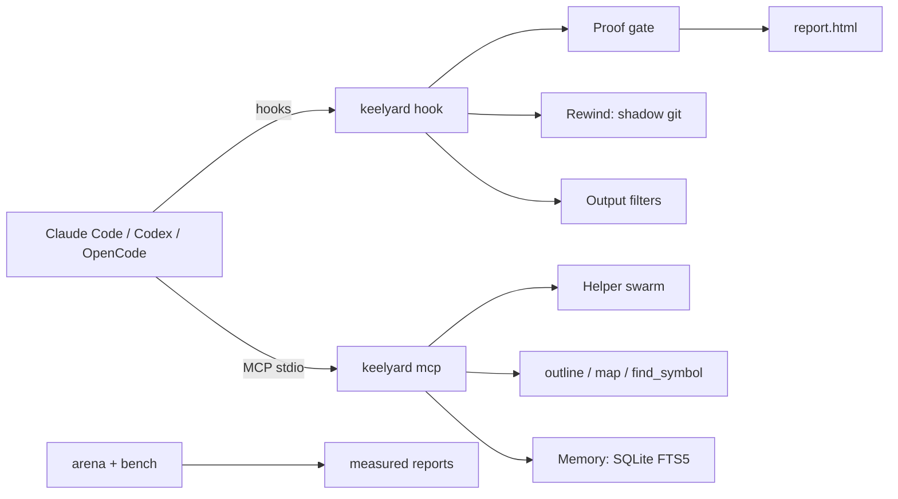
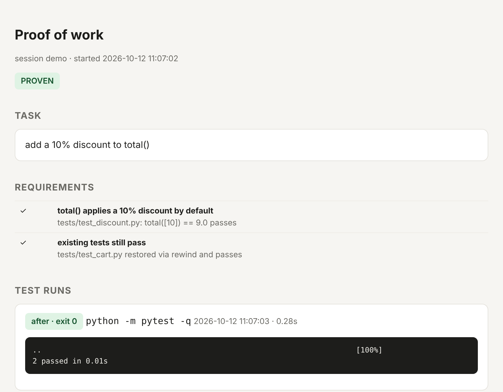
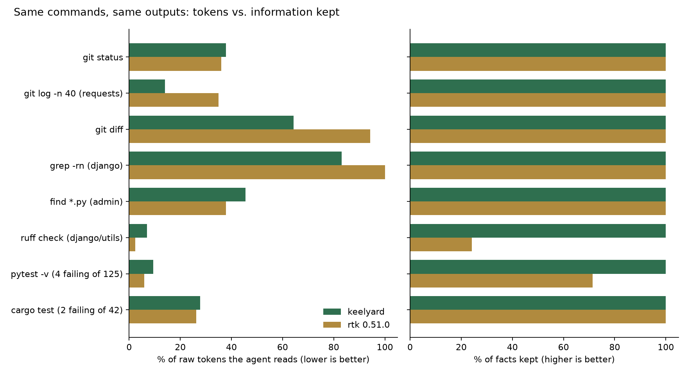

<div align="center">

# keelyard

**Make AI coding agents prove their work, undo their mistakes, and spend fewer tokens.**

[](https://github.com/akobirjontulqinovfuture/keelyard/actions/workflows/ci.yml)
[](LICENSE)


</div>

keelyard plugs into Claude Code, Codex and OpenCode through their own hooks and MCP. Nothing sits
between you and your model provider, so it works on $20 subscription plans as well as API keys.
Everything runs locally.



## What it does

| | Problem | What keelyard does |
|---|---|---|
| **Proof** | The agent says "done", but nothing was run | A Stop-hook gate: if files changed, the agent can't finish without a requirement checklist, a passing test run after its last edit and, for web apps, a screenshot. You get a self-contained HTML report. |
| **Rewind** | It deleted the wrong thing three steps ago | A snapshot after every edit or shell call, kept in a separate shadow git repo (your `.git` is never touched). `rewind`, `fork` and diff by step, in a TUI or over MCP. |
| **Saver** | Logs and repeat reads eat the context window | Command-aware filters for git, pytest, cargo/go/jest, grep, find and ruff/eslint/mypy that keep every failure and drop the noise. Claude Code's `PostToolUse` swaps in the filtered result, and the raw output stays one `keelyard recall <id>` away. Repeat reads of unchanged files are blocked until the next compaction. |
| **Structure first** | The agent reads 3,000 lines to find one function | `project_map`, `outline` (signatures with line numbers) and `find_symbol` over MCP |
| **Swarm** | Bulk reading on an expensive model | Fans read/summarise/draft tasks out to many cheap or local model calls. Answers must cite `path:line` (checked); patches must pass `git apply --check` and are never applied automatically. |
| **Memory** | Last week's fix lives in another agent's history | Indexes Claude Code, Codex and OpenCode transcripts (secrets redacted) in local SQLite FTS5 and returns short snippets under a budget |
| **Usage** | "Where did my limit go?" | Per day, model or agent token totals from all three agents' local logs; cost only from prices you configure |
| **Arena** | "Which agent and model is actually better at *my* task?" | Runs one task across agents and models in fresh copies and measures pass rate, time, tokens and cost. Writes `results.json`, `report.html` and `chart.png`. |

<p align="center"></p>

## Install

```bash
pip install git+https://github.com/akobirjontulqinovfuture/keelyard     # PyPI release pending
cd your-project
keelyard install claude      # .claude/settings.json hooks + .mcp.json
keelyard install codex       # .codex/hooks.json (approve with /hooks) + MCP snippet for ~/.codex/config.toml
keelyard install opencode    # .opencode/plugin/keelyard.js + opencode.json
```

Installs are idempotent and merge with your existing config. Settings live in `.keelyard/config.toml`.
That directory git-ignores itself.

## Try it

```bash
bash examples/demo.sh        # replays real Claude Code hook payloads in a throwaway repo
```

In the demo, the "agent" edits code and deletes the tests, and the gate blocks it from stopping. You rewind
just the deletion, then record proof, and the gate opens and writes the report shown above.

```text
keelyard x -- pytest -v              # run anything with command-aware filtering
keelyard outline src/app.py          # signatures + line numbers
keelyard map | keelyard sym parse_config
keelyard timeline -i                 # TUI: enter = diff, r = rewind
keelyard rewind 7 | keelyard fork 7 ../try-b
keelyard usage --by model
keelyard mem ingest && keelyard mem search "stripe webhook signature"
keelyard arena run examples/arena/discount/task.toml
keelyard bench
```

MCP tools: `proof_requirements` `proof_check` `proof_run_tests` `proof_screenshot` `proof_status`
`rewind_list` `rewind_diff` `rewind_to` `read_file` `run_compact` `recall` `outline` `project_map`
`find_symbol` `route_task` `swarm` `swarm_verify` `memory_search` `usage_report`.

## Measured, not claimed

Every number below was produced by a script in this repo, on an 8-core Linux box without a GPU, on 2026-10-12.
Tokens are approximate (`chars/4`) and only meant for comparison. Methods and raw data: [docs/BENCHMARKS.md](docs/BENCHMARKS.md).

**Head-to-head with rtk 0.51.0** on the same 8 real commands ([bench/vs_rtk.py](bench/vs_rtk.py)). "Facts kept" means
the share of failing test ids, assertion lines, changed paths, grep hits and lint locations from the raw output that
are still present after filtering.

<p align="center"></p>

| | raw | keelyard | rtk |
|---|---|---|---|
| tokens (8 commands) | 56,522 | 5,901 | 5,747 |
| commands with 100% facts kept | n/a | 8/8 | 6/8 (ruff 24%, pytest 71%) |

The token savings are about even. The difference is that keelyard kept everything the agent needs to act.
That is a small sample, and rtk covers far more commands (100+ vs our 8 families), so read it as
"comparable savings, stricter about keeping information", not as a general win.

| Other measurements | Result |
|---|---|
| Filter on 6 real build/test logs (`bench/corpus`) | −52.1% tokens overall; −90% git clone, −64% failing pytest, no gain on short logs |
| Snapshot after a one-file edit | 11 ms median (36 files); 72 ms median (Django, 7,083 files; first snapshot 2.1 s) |
| Swarm with a 1.5B local model on CPU | 3/12 tasks verified; 0/8 answers cited correctly, and the verifier flagged all of them. Use a 7B+ or hosted cheap model. |
| Swarm fan-out (mock server) | 200 tasks under a concurrency cap of 50; 20/20 planted bad citations caught |

Not measured yet: read-dedupe and memory savings on real transcripts (the build box had none; run `keelyard bench` on
yours), and Arena on real agents (it needs logged-in CLIs; the pipeline itself is tested with scripted agents).

## Verified vs not verified

- **Verified by the test suite (32 tests):** Claude Code hook JSON in and out through the real CLI, including
  `PostToolUse` output replacement; the MCP stdio server driven by the official MCP client; snapshot, rewind and fork;
  the proof gate lifecycle; filters; outline and symbol lookup; usage and transcript parsing for all three agents
  (fixtures shaped like their formats); the arena pipeline; installers.
- **Not yet verified against live agents:** Codex hooks (they use the Claude-compatible `hooks.json` format) and the
  OpenCode plugin API (`tool.execute.*`, `session.idle`). Real Arena runs also wait on logged-in agent CLIs.

## Security

Local-first. Secrets are redacted before anything is stored or sent to a helper model, `memory.db` is mode 600,
commands run without a shell, `read_file` can't leave the project, swarm patches are never auto-applied, and a failing
hook never breaks the agent. See [SECURITY.md](SECURITY.md).

## Credits

The filters, structure-first reading and usage report build on ideas from
[rtk](https://github.com/rtk-ai/rtk), [repomix](https://github.com/yamadashy/repomix),
[claude-context-optimizer](https://github.com/AzozzALFiras/claude-context-optimizer),
[ccusage](https://github.com/ccusage/ccusage) and [tokensave](https://github.com/aovestdipaperino/tokensave).
They are reimplemented here, with no code copied. See [NOTICE](NOTICE).

## Contributing

Contributions are welcome, especially new agent adapters, filters backed by real output samples, and benchmark
runs on your machine. See [CONTRIBUTING.md](CONTRIBUTING.md) and the
[good first issues](https://github.com/akobirjontulqinovfuture/keelyard/labels/good%20first%20issue).

## License

Apache-2.0
