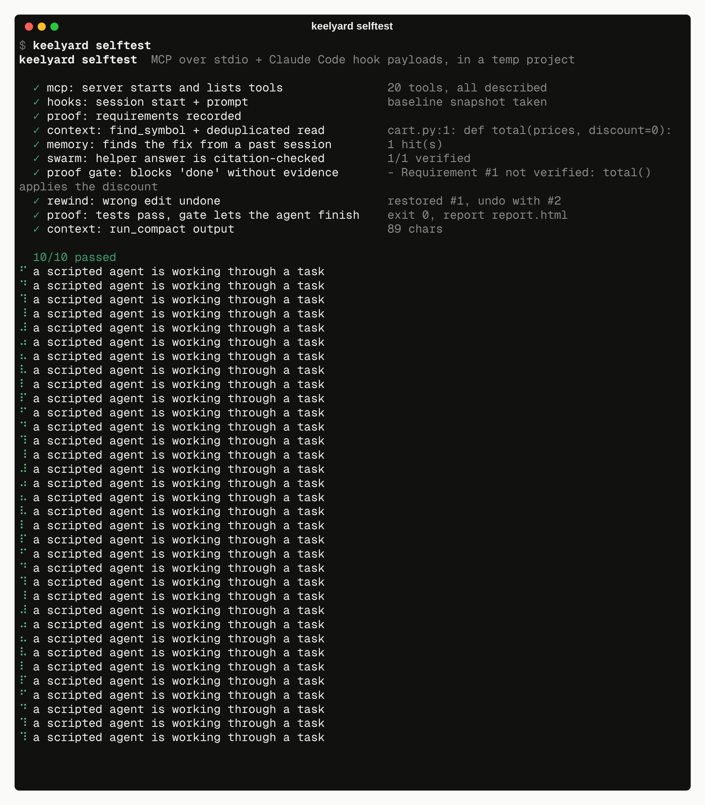

# For agents

keelyard is meant to be driven by agents. Everything a person can do from the CLI, an agent can do through
MCP, and both return JSON.

## What `init` installs

| agent | hooks | MCP | instructions |
|---|---|---|---|
| Claude Code | `.claude/settings.json` | `.mcp.json` | `CLAUDE.md` section, `.claude/skills/keelyard/SKILL.md`, `/keelyard:status`, `/keelyard:prove`, `/keelyard:undo` |
| Codex | `.codex/hooks.json` | snippet for `~/.codex/config.toml` | `AGENTS.md` section |
| OpenCode | `.opencode/plugins/keelyard.js` | `opencode.json` | `AGENTS.md` section |

The instruction sections sit between `<!-- keelyard:start -->` and `<!-- keelyard:end -->`. `init` replaces only
that block, and `uninstall` removes only that block. The rest of the file stays as you wrote it.

## The loop an agent follows

1. `proof_requirements(items=[...])`
2. `project_map`, `find_symbol`, `outline`, then `read_file`
3. edit (snapshots happen automatically)
4. `run_compact` for tests and builds
5. `proof_run_tests(phase="after")`, then `proof_check` for each item
6. `proof_status` → `{"proven": true}`

All 20 tools are listed, with their schemas, in the [MCP reference](../mcp.md).

## Self-test

`keelyard selftest` plays the agent. It sends the same hook JSON Claude Code sends and does everything else
through the MCP server over stdio. In a temporary project it records requirements, reads code, searches
memory, runs a swarm task against a local stub model, makes a bad edit, gets blocked by the gate, rewinds,
fixes the bug, proves it and is let through. It needs no network and no API key.

