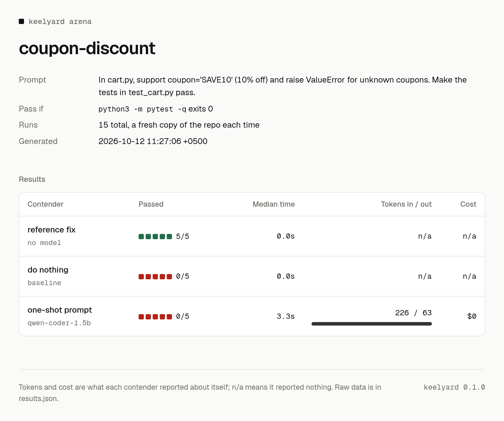

# Arena

The arena runs the same task across several agents and models. Each run gets a fresh copy of the
repository, and the task's check command decides pass or fail. Tokens and cost come from each agent's own
machine-readable output. If an agent reports nothing, the cell says `n/a`. Nothing is estimated.

```bash
keelyard arena run examples/arena/discount/task.toml --out arena-results
keelyard arena render arena-results       # re-render from results.json
```

`task.local.toml` runs without any agent CLI or API key. It uses a local model through Ollama and two
baselines: "do nothing" and the reference fix.



The report above is a real run: the 1.5B one-shot contender passed 0 of 5. We have not run
Claude Code, Codex or OpenCode through the arena on this machine yet. When we do, the results go in
[Benchmarks](../BENCHMARKS.md).

Agent CLI flags change between releases. Check the `cmd` lines in `task.toml` against the versions you
have installed.
