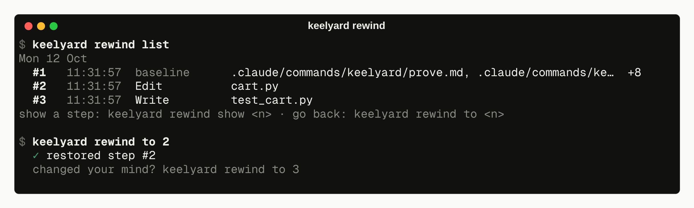
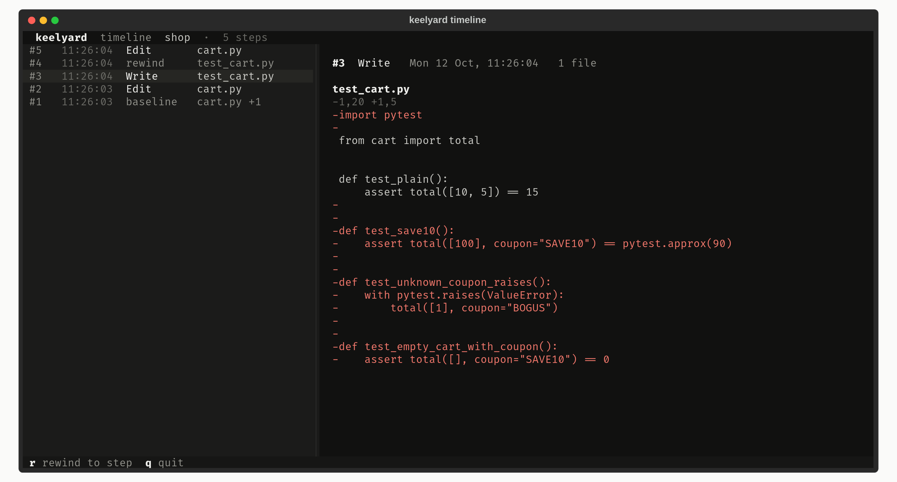
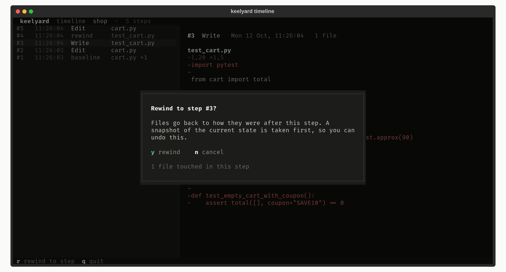

# Rewind

After every edit or shell command, keelyard snapshots the project into `.keelyard/shadow.git`. That is a
separate git repository: your `.git`, index, stash and branches are never touched. Snapshots follow
`.gitignore`. Files over `[rewind].max_file_mb` (20 MB by default) are skipped and listed as skipped. Nested
repositories, such as monorepo packages that have their own `.git`, are included file by file.

```bash
keelyard rewind list         # -n 100 for more, -i for the timeline browser
keelyard rewind show 12      # the diff step 12 made
keelyard rewind to 9         # files back to how they were after step 9
keelyard rewind fork 9 ../b  # copy step 9 into another folder and try a different approach there
keelyard rewind snap         # snapshot now
```



`rewind to` takes a snapshot of the current state first and prints its number. To undo the rewind,
rewind to that number. Files that were created after the target step are removed. Files that were
deleted are restored.

## Timeline browser

`keelyard rewind list -i` shows steps on the left and the diff of the selected step on the right. Press `r`
to rewind to the selected step.





## Cost

On a 7,083-file Django checkout, a snapshot after an edit takes 88 ms (median). The first snapshot takes
2.3 s, because it hashes every file. Concurrent hooks are serialised with a lock file, so two agents saving
at the same moment cannot corrupt the timeline.
