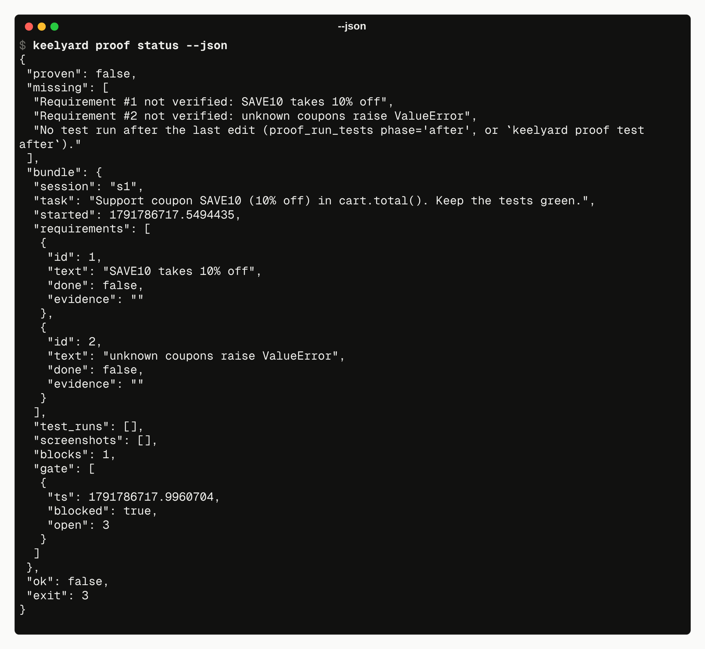

# Exit codes and JSON

| code | meaning |
|---|---|
| `0` | success |
| `1` | error. The message says what went wrong, and a `hint:` line says what to do. |
| `2` | usage error: unknown command, missing or bad argument |
| `3` | a check did not pass: `doctor` found a problem, `proof status` is not proven, `proof test` failed, `selftest` failed |

`keelyard run` exits with the exit code of the command it ran.

With `--json`, a command prints exactly one JSON object to stdout and nothing else. The object always has
`ok` and `exit`:

```json
{"proven": false, "missing": ["Requirement #2 not verified: unknown coupons raise ValueError"], "ok": false, "exit": 3}
```

Errors keep the same shape:

```json
{"ok": false, "exit": 1, "error": "no step 42 (steps 1-4 exist).", "hint": "run `keelyard rewind list`."}
```


